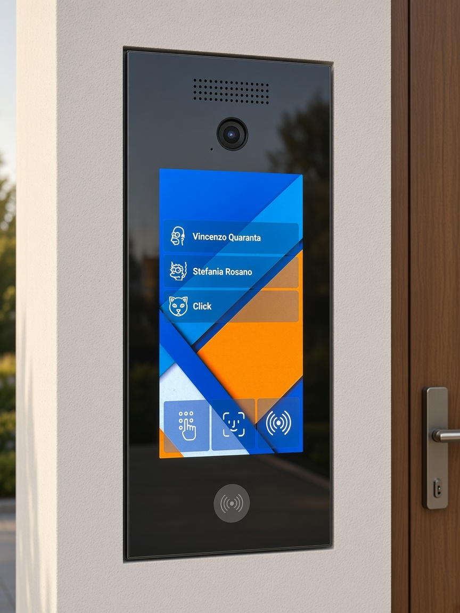

# Smartofono

Videocitofono da incasso con pannello in vetro a filo muro, costruito attorno a
un **Raspberry Pi 5** e integrato in **Home Assistant**. Non è un prodotto
commerciale modificato: sono il progetto meccanico, i disegni di produzione e il
software, nati insieme per un impianto che funziona.



Dalla parte esterna c'è un vetro nero da 100 x 240 x 2 mm, con un display OLED
da 5,5 pollici incollato dietro, la camera, il lettore NFC e l'audio
bidirezionale. Dall'interno, Home Assistant squilla sui tablet di casa, mostra
il video, apre il cancello e tiene il registro delle chiamate con i filmati.

L'unico dettaglio visibile del montaggio è una **fessura d'ombra di 3 mm** su
tutto il perimetro, che è anche la via d'aria: le feritoie di ventilazione si
affacciano lì dentro e guardando il pannello di fronte non si vedono.

---

## Com'è fatto

```
hardware/          progetto meccanico: parametri, disegni, modello 3D, render
installer-rpi/     l'app che gira sul pannello (Python + Kivy) e il suo installer
installer-ha/      package, card e automazioni per Home Assistant
```

### hardware — il pannello

Tutte le quote nascono da **un unico file di parametri**, quindi i disegni 2D e
il modello 3D non possono divergere. `parametri.py` non si limita a tenere i
numeri: cerca le compenetrazioni fra componenti e **esce con errore** se due
pezzi occupano lo stesso volume. È il controllo che ha fatto emergere la metà
degli errori di questo progetto, compreso un altoparlante che collideva con la
camera e una squadretta che finiva sotto il disco NVMe.

| Documento | Cosa contiene |
|---|---|
| [hardware/README.md](hardware/README.md) | il progetto e il perché di ogni scelta |
| [hardware/PRODUZIONE.md](hardware/PRODUZIONE.md) | cosa ordinare, a chi, cosa controllare |
| [hardware/ASSEMBLAGGIO.md](hardware/ASSEMBLAGGIO.md) | il montaggio, passo per passo |
| [hardware/MISURE.md](hardware/MISURE.md) | il rilievo col calibro dei pezzi reali |

Per rigenerare disegni e modello dopo una modifica alle quote:

```bash
cd hardware
python3 parametri.py      # verifica le interferenze, esporta le quote
python3 genera_dxf.py     # i sette DXF
python3 anteprime.py      # i PNG di controllo
./genera_3d.sh            # render e STL (richiede OpenSCAD)
```

I due script intermedi hanno bisogno di `ezdxf` e `matplotlib`:

```bash
python3 -m venv .venv-cad && .venv-cad/bin/pip install ezdxf matplotlib
```

### installer-rpi — il pannello esterno

Applicazione Kivy a schermo intero. Quello che fa, nell'ordine in cui lo si
incontra usandolo: mostra l'indirizzo a riposo, squilla su Home Assistant
quando si tocca un campanello, apre la conversazione audio-video, e apre il
cancello da PIN, da badge NFC o riconoscendo un volto.

```bash
cd installer-rpi
cp app/config/config.example.yaml app/config/config.yaml
# compila almeno le sezioni mqtt, home_assistant e campanelli
sudo ./scripts/install.sh
```

### installer-ha — la parte interna

```bash
cd installer-ha
cp secrets.yaml.example /config/secrets.yaml   # e riempilo
./install.sh
```

L'installer copia package, pyscript, card e temi, poi **controlla che in
`secrets.yaml` ci siano tutte le chiavi** che i package richiedono: senza
quelle Home Assistant non riparte, ed è un errore che si scopre col sistema
già giù.

---

## Hardware

| Componente | Modello | Note |
|---|---|---|
| Single board computer | Raspberry Pi 5 8 GB | Raspberry Pi OS Bookworm 64 bit, avvio da NVMe |
| Alimentazione e rete | PoE HAT (F) Waveshare | un cavo solo fino al pannello |
| Display | OLED 5,5" 1080x1920, HDMI + touch USB | emissivo: il nero è spento, e si attenua in software |
| Camera | Raspberry Pi Camera Module 3 (IMX708) | variante standard, non wide |
| NFC | PN532 su USB | l'antenna non è centrata sul PCB: conta per il montaggio |
| Audio | HAT I2S + microfono su basetta separata | cancellazione d'eco in PipeWire |
| Unità interna | Home Assistant OS | MQTT, LiveKit per le videochiamate |

Il display è **OLED e non IPS**, nonostante la scheda prodotto dica entrambe le
cose. Lo dimostrano due prove indipendenti, raccontate in
[hardware/README.md](hardware/README.md): il pannello nudo misura 0,4 mm col
calibro, troppo poco per starci un backlight, e il nero **resta nero guardando
lo schermo di sbieco a 45°**, dove un IPS perde l'allineamento dei cristalli e
schiarisce. Cambia due cose concrete: la luminosità notturna si abbassa in
software, senza un pin dedicato, e il **burn-in** diventa l'unico rischio da
mitigare.

---

## Stato

Il **progetto meccanico è completo e verificabile**: i sette disegni, il modello
3D e gli STL si rigenerano da zero e il controllo interferenze passa. Il rilievo
col calibro dei componenti reali è finito, quindi il vetro — il pezzo
irreversibile — si può ordinare.

Il **software gira su un impianto reale** da mesi: chiamata, video, apertura
cancello, NFC, PIN, riconoscimento facciale, registro chiamate con i filmati,
annunci vocali, pannello di salute.

Resta aperto:

- il **lettore di impronte** è uno stub (`fingerprint_reader.py`): l'hardware
  non è ancora collegato, la schermata e l'API ci sono;
- il **reed switch** antimanomissione è previsto nel telaio ma non acquistato;
- alcune prove a banco elencate in [hardware/MISURE.md](hardware/MISURE.md):
  il touch attraverso il vetro, la portata NFC attraverso vetro e alluminio,
  la prova termica a scatola chiusa.

---

## Replicarlo

Il progetto nasce per un muro in particolare, ma le quote sono tutte
parametriche: cambiare la larghezza del vetro o la profondità della cassa è una
riga in `hardware/parametri.py`, e i disegni seguono. Due cose vanno comunque
adattate:

- **gli indirizzi di rete**. Gli script usano `${VAR:-default}` e i default
  sono della rete di sviluppo: si passano da variabile d'ambiente, per esempio
  `HA_HOST=192.168.0.10 ./install.sh`;
- **i segreti**. Non ce n'è nessuno nel repository: `secrets.yaml.example`
  elenca le chiavi da generare, e i segreti di LiveKit si fanno con
  `openssl rand -hex 32`.

---

## Crediti e licenza

Le icone in `installer-rpi/app/assets/avatars/` vengono da
[Icons8](https://icons8.com) e restano soggette alla loro licenza: se usi questo
progetto, l'attribuzione a Icons8 va mantenuta oppure le icone vanno sostituite.
I dettagli sono in [NOTICE](NOTICE).

Il resto — disegni, parametri, codice e documentazione — è pubblicato con
licenza MIT: vedi [LICENSE](LICENSE).
