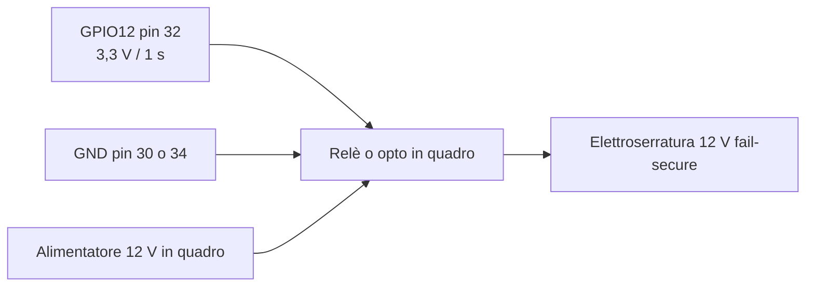
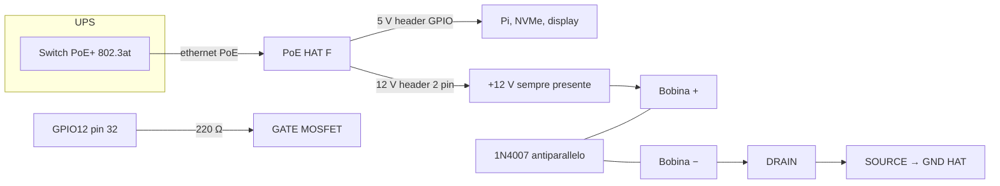

# Apertura porta: segnale, alimentazione, schema

Il Raspberry **comanda** l'apertura. L'elettroserratura ha bisogno di
**12 V e corrente da bobina**: quelli non escono dalla GPIO.

Due impianti, a seconda di dove sta l'energia della serratura. Lo schema B
serve quando lo switch PoE+ è sotto UPS e la serratura, in blackout, resterebbe
senza rete.

Il **cancello strada** non si alimenta da qui: ha il suo quadro. GPIO13 resta
solo il pilota di quel relè.

## Cosa deve essere l'elettroserratura

| Parametro | Obbligatorio | Fuori specifica |
|---|---|---|
| Tensione | **12 V DC** | 24 V, 12 V AC, rete 230 V |
| Tipo | scrocco / elettroserratura **a impulso**, **fail-secure** (senza tensione resta chiusa) | ventosa magnetica (assorbe in continuo), fail-safe (senza tensione si apre) |
| Assorbimento nominale | **≤ 800 mA** a 12 V | oltre 1 A |
| Spunto (inrush) | **≤ 1 A**, misurato a freddo per almeno 50 ms | spunto da 2–3 A da solenoidi da cancello |
| Durata comando | 1 s (`relay.pulse_ms: 1000`) | tenuta continua |
| Polarità | DC, con diodo di ricircolo in parallelo alla bobina | bobina nuda sull'HAT |

Fail-secure più impulso da 1 s è quello che il software già emette. Una ventosa
andrebbe tenuta in tensione per tutto il tempo in cui la porta è chiusa: i
watt restano sul PoE e in chiamata il budget non basta.

Prima di chiudere i morsetti, misura nominale e spunto con un tester in serie
(o una pinza). Se lo spunto supera 1 A, schema B non si usa: si torna allo
schema A con alimentatore in quadro, eventualmente con batteria 12 V locale.

## Da dove esce cosa

| Segnale | Dove | Cosa c'è | Cosa non c'è |
|---|---|---|---|
| Comando porta | **GPIO12**, pin fisico **32**, 3,3 V, 1 s | impulso verso MOSFET o relè | alimentazione della bobina |
| Comando cancello | **GPIO13**, pin **33**, stesso impulso | solo pilota | 12 V dell'HAT |
| Massa logica | pin **30** o **34** | comune col GND dell'HAT | — |
| 12 V serratura | header **2 pin** dell'HAT PoE (F), serigrafia `12V` / `GND` | fino a 2 A di targa, **condivisi** coi 5 V | i 5 V del GPIO, i 3,3 V |

L'HAT dichiara **5 V / 4,5 A** sull'header GPIO, **12 V / 2 A** sul 2 pin, e
**25 W totali** fra le due uscite. PoE+ all'ingresso sono 25,5 W; col rendimento
dell'HAT (~87%) il DC utile è circa 22 W. Il pannello a riposo sta sui 5 W, in
chiamata verso 11 W. Per la serratura restano, in pratica:

- a riposo, un impulso da **0,8 A @ 12 V** (circa 10 W per 1 s) entra;
- in chiamata contemporanea all'apertura, stare **sotto 0,8 A**;
- i «2 A» stampati sull'HAT non sono il margine: sono il tetto dell'uscita
  **se il Raspberry non assorbisse nulla**.

I 5 V dell'header GPIO alimentano già Pi, NVMe e display. La serratura **non**
si attacca lì.

## Schema A — relè in quadro (rete 230 V sulla serratura)

È lo schema di default se l'UPS dello switch **non** deve tenere anche la
porta. Nella cassa non entra nessun relè di potenza.

```
  Raspberry Pi 5                         Quadro                            Porta
 ┌──────────────────┐                 ┌─────────────┐                 ┌──────────┐
 │ GPIO12 pin 32 ───┼── pilota 3,3 V ─┤ bobina relè │                 │          │
 │ GND pin 30/34 ───┼── massa ────────┤             │   12 V DC      │ scrocco  │
 └──────────────────┘   2° corrugato  │ contatto NO ├── commutato ───┤ 12 V     │
                                      │             │                └──────────┘
                                      │ PSU 12 V ───┤
                                      └─────────────┘
```



In blackout, se il PSU del quadro non è sotto UPS, il citofono resta acceso
(PoE) e l'impulso esce, ma la porta non si muove.

## Schema B — 12 V dall'HAT PoE (serratura sotto UPS)

Lo switch PoE+ sta sotto UPS. L'unico punto già alimentato vicino alla porta è
il citofono. I 12 V dell'HAT arrivano da lì: in blackout la serratura ha
energia.

Nella cassa **non entra un relè elettromeccanico**. Entra un MOSFET piccolo
(o un modulo optoisolato logic-level 3,3 V), che per 1 s disperde poco calore.

Commutazione **low-side**: il positivo 12 V va sempre alla bobina, il MOSFET
chiude il ritorno a massa.

```
  PoE HAT (F)              MOSFET N logic-level 3,3 V           Elettroserratura
 ┌────────────┐            ┌─────────────────────┐              ┌──────────────┐
 │ 12V (+) ───┼──── rosso ─┼─────────────────────┼──────────────┤ bobina +     │
 │            │            │                     │              │              │
 │ GND  (-) ──┼─┬── nero ──┤ SOURCE              │     ritorno  │ bobina −     │
 └────────────┘ │          │ DRAIN ──────────────┼──────────────┤              │
                │          │ GATE                │   2° corrugato└──────┬───────┘
  Pi GPIO12     │          └────────▲────────────┘                      │
  pin 32 ───────┼──── 220 Ω ────────┘                                   │
  pin 30/34 GND─┘                                                       │
                                                                        │
                    1N4007 in antiparallelo: catodo sul +, anodo sul − ─┘
```



### Pin e colori

| Filo | Origine | Destinazione |
|---|---|---|
| Rosso 12 V | header 2 pin HAT, pad `12V` | morsetto **+** della serratura |
| Nero massa | header 2 pin HAT, pad `GND`, e pin 30 o 34 del Pi | SOURCE del MOSFET **e** comune di ritorno |
| Giallo comando | pin 32 (GPIO12) | GATE del MOSFET, in serie 220 Ω |
| Bianco ritorno bobina | morsetto **−** della serratura | DRAIN del MOSFET |

Polarità dell'header 2 pin: fidarsi della **serigrafia** sull'HAT, non del
verso del connettore. Invertire 12 V e GND brucia il MOSFET.

Nel secondo corrugato viaggiano **due fili** da 0,5–0,75 mm² (rosso e bianco).
Il giallo resta in cassa. Se la corsa fino alla porta è lunga e si teme il
rumore, il MOSFET può stare in quadro: allora nel corrugato vanno 12 V, GND,
comando 3,3 V e ritorno bobina, e il diodo resta comunque ai capi della bobina,
non in cassa.

### MOSFET e protezione

| Pezzo | Specifica |
|---|---|
| MOSFET (o modulo) | N-channel **logic-level**, si apre tutto a **Vgs = 3,3 V**; Vds ≥ 20 V; Id ≥ 3 A |
| Resistenza di gate | 220 Ω in serie sul pin 32 |
| Diodo di ricircolo | 1N4007 o Schottky 40 V, **catodo sul +12 V**, anodo sul − della bobina |
| Opzionale | TVS 15–18 V in parallelo all'uscita 12 V dell'HAT |

Non usare un IRLZ44 «generico» alimentato a 3,3 V: a quella Vgs spesso non è
completamente aperto e scalda. Un modulo MOSFET con ingresso 3,3 V e
optoisolatore va bene, purché il carico dichiarato sia 12 V DC ≥ 3 A.

### Cosa non fare

- serratura sui **5 V** del GPIO o sui pin 2/4 (SSD e display cadono al click);
- 12 V HAT **diretti** sulla bobina, senza MOSFET (la porta resterebbe in
  tensione per tutto il tempo in cui c'è PoE);
- ventosa magnetica sull'HAT;
- alimentare anche il **cancello** dai 12 V (GPIO13 resta pilota verso il
  suo quadro);
- relè elettromeccanico in cassa (bobina, arco, calore, rumore in chiamata).

## Prova a banco, prima della posa

1. Misura l'elettroserratura a 12 V: nominale e spunto. Annota i due numeri.
2. Collega lo schema B **senza** il Raspberry: applica 3,3 V al GATE e verifica
   che lo scrocco scatti per ~1 s.
3. Solo dopo, GPIO12 e PoE. Un'apertura da PIN a pannello acceso non deve far
   comparire `throttled` diverso da `0x0` (`vcgencmd get_throttled`) e non deve
   far riavviare display o SSD.
4. Ripeti l'apertura **durante una chiamata**. Se il pannello si resetta, lo
   spunto è troppo: schema A, o serratura più leggera.

Il software non cambia: `relay.porta_gpio: 12`, `pulse_ms: 1000`. Cambia solo
il carico attaccato a quell'impulso.
